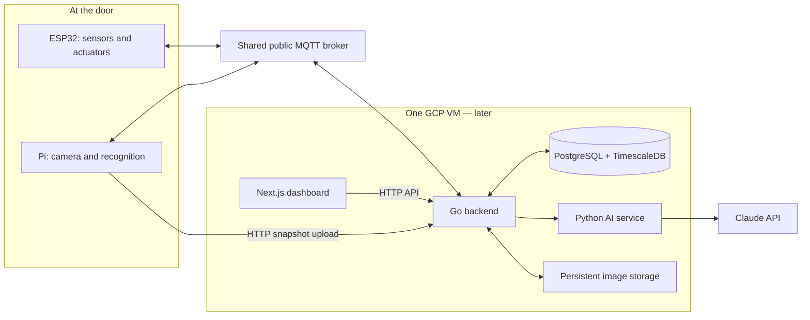

# Smart Door — Final Frontend, Backend, and Infrastructure Plan

> **Integration update (2026-11-24):** The team selected `test.mosquitto.org` for a college demo. The Pi, ESP32, and Go API connect directly to that public broker with the same unique topic prefix; there is no Pi broker or bridge. This repository implements the Go API and dashboard connection only; teammates own the Pi and ESP32 clients. The simulator and local Mosquitto run only in the `sim` Compose profile. Automatic unlocking through MQTT requires internet access. The team chose raw messages, including face embeddings, on this anonymous broker. See `docs/mqtt-topics.md` and the root README for the current connection contract and setup. Sections below describing the Pi broker, bridge, and offline automatic unlock are superseded by this update.

> **Telemetry update (2026-11-24):** Device readings now arrive on five `sensor/*` topics with per-sensor values, validity, and sequence metadata. The earlier bundled `door/node/state` and `door/gateway/telemetry` descriptions below are superseded by `docs/mqtt-topics.md`.

## 1. Goal and agreed architecture

Build a simple school-project dashboard that monitors the door, stores continuous sensor history, displays face-scan events, manages trusted faces, and sends manual lock/unlock commands.

**No application authentication:** no login page, accounts, roles, sessions, or OAuth. The dashboard, HTTP API, and Scalar documentation open directly.

| Component | Decision |
|---|---|
| Frontend | Next.js + TypeScript |
| Backend | Go + Chi |
| Database | PostgreSQL + TimescaleDB |
| API documentation | OpenAPI + Scalar |
| Local MQTT broker | None in real-device mode; local Mosquitto is simulation-only |
| Cloud MQTT connection | `test.mosquitto.org` |
| Edge/cloud connection | Pi and ESP32 connect directly to the public broker |
| AI service | Teammate-built Python service |
| Claude integration | Python AI service makes the calls |
| Deployment | Docker Compose on one GCP Compute Engine VM |
| IaC | Terraform, prepared in the later deployment phase |



The Pi sends automatic unlock requests through the public broker to the ESP32. Internet and broker availability are required for that path. Cloud features provide enrollment, synchronization, history, manual commands, and visitor descriptions.

## 2. Responsibilities and integration contracts

### Your part

Implement the frontend, Go backend, TimescaleDB schema, MQTT ingestion and publishing, image upload/storage, enrollment coordination, API documentation, simulator, and later GCP deployment.

### Teammates’ part

- **ESP32 owner:** sensor readings, debounce, solenoid/buzzer control, command results, auto-relock, and tamper behavior.
- **Pi owner:** public-broker MQTT client, camera, local face recognition, cached embeddings, and snapshot uploads.
- **AI owner:** Python embedding and visitor-analysis endpoints, model compatibility, image-quality checks, and Claude requests.

Thresholds, voting, anti-spoofing, and actuator timing belong to the edge/AI implementation. Your backend stores their reported results and metrics.

### HTTP API

Use `/api/v1` for application endpoints.

| Endpoint | Purpose |
|---|---|
| `GET /devices/door-01/state` | Latest readings, reported states, presence, and connectivity |
| `GET /devices/door-01/readings` | Time-filtered sensor history |
| `GET /devices/door-01/events` | Paginated access and security history |
| `POST /devices/door-01/commands` | Request lock/unlock |
| `GET /trusted-people` | List people and synchronization status |
| `POST /trusted-people` | Create a person |
| `POST /trusted-people/{id}/enrollments` | Upload photos and process enrollment |
| `GET /enrollments/{id}` | Enrollment outcome |
| `DELETE /trusted-people/{id}` | Remove the person and synchronize the updated face list |
| `POST /snapshots` | Receive a Pi snapshot associated with an event ID |
| `GET /snapshots/{id}` | Retrieve a stored snapshot |
| `GET /devices/door-01/events/export` | CSV export for evaluation |
| `/health/live`, `/health/ready` | Process and dependency health |

Serve Scalar at `/docs` and the OpenAPI document at `/openapi.json`. Generate Go request/response types and handler interfaces with `oapi-codegen`, and generate TypeScript types from the same specification.

Browser requests use the same origin through a reverse proxy. Commands and enrollments return tracking IDs with `202 Accepted`. Validation errors use consistent JSON responses.

### Python AI interface

The Go backend calls the Python container over the internal deployment network.

- `POST /ai/faces/embed`: accept 3–5 photos; return accepted embeddings, quality results, rejected-image reasons, and model version.
- `POST /ai/triage`: accept a snapshot and event context; return category, description, people count, optional observed items, and confidence.

Use the shared chat’s proposed embedding contract: 128-dimensional SFace embeddings and at least two accepted images per enrollment. Cloud and Pi must use compatible model files and preprocessing.

The AI owner supplies the working Claude model identifier through configuration. Do not copy unverified model names from the shared chat into the implementation.

## 3. Data flows and application behavior

### MQTT routing

Keep the team’s topic names locally. On the public broker, place them under a configurable, unique project prefix:

```text
Local:  door/access/event
Public: <project-prefix>/door/access/event
```

| Local topic | Bridge direction | Purpose |
|---|---|---|
| `door/node/state` | Edge → cloud | Contact state, lock report, temperature, and heartbeat |
| `door/node/alert` | Edge → cloud | PIR, vibration, and tamper events |
| `door/gateway/telemetry` | Edge → cloud | ToF distance, lux, LED state, and gateway heartbeat |
| `door/access/event` | Edge → cloud | Recognition results and evaluation metrics |
| `door/cmd/result` | Edge → broker | Optional execution result; the API does not subscribe |
| `door/faces/status` | Edge → cloud | Applied face-list version or synchronization error |
| `door/cmd/lock` | Cloud → edge | Manual lock/unlock request |
| `door/faces/sync` | Cloud → edge | Retained, complete face-cache snapshot |

The API, Pi, and ESP32 use the same public topic prefix. Pi-generated automatic unlock commands use `door/cmd/lock`; devices may report results through `door/cmd/result` for other consumers.

Configure the public hostname, port, protocol, and project prefix through environment settings. The selected endpoint is still pending from the team; this does not change the architecture.

Use unique MQTT client IDs. Commands and events carry IDs for duplicate handling. Never retain action commands. Use retained messages for complete face snapshots and timestamped current state only.

### Continuous readings and history

- Combine the latest ESP32 and Pi sensor values into one readings-history snapshot every five seconds. Keep individual latest values for the overview. Existing per-message history remains until retention removes it.
- Gateway telemetry defaults to every five seconds; node telemetry/heartbeat defaults to every ten seconds.
- Record state changes and alerts immediately.
- Use UTC timestamps and distinguish device-recorded time from server-received time.
- Store temperature in Celsius, distance in millimetres, and BH1750 light readings in lux.
- Missing measurements remain empty; do not substitute zero.
- Mark each component offline after 30 seconds without activity.

Use TimescaleDB hypertables for continuous readings and ordinary PostgreSQL tables for people, embeddings, events, enrollments, and synchronization state. The existing commands table is preserved but receives no new writes.

Default retention: 30 days for readings and snapshots; 90 days for events.

### Manual door commands

Publish each command without storing it. Respond once the MQTT broker confirms publication, without waiting for a device result. The dashboard shows that the command was sent, not that it was executed.

Commands expire after ten seconds. The device rejects expired or previously executed commands. The backend accepts manual requests regardless of sensor freshness, but requires an MQTT connection to publish them.

Magnetic-contact readings independently report whether the door is open or closed. The manual command response does not verify lock movement.

### Enrollment and deletion

1. User creates a person and uploads 3–5 JPEG/PNG photos, up to 5 MB each.
2. Go validates the uploads and calls `/ai/faces/embed`.
3. If fewer than two images are accepted, show the rejection reasons.
4. Store accepted embeddings with their model version.
5. Increment a database-backed face-list version and publish the complete retained snapshot.
6. Pi validates compatibility, replaces its cache, and acknowledges the applied version.

Show **enrolled in cloud** and **synced to door** separately.

Deletion removes the person’s embeddings and enrollment photos, increments the version, and republishes the complete list—even when the list becomes empty. Show removal as pending until Pi acknowledgment.

Do not retain enrollment photos after processing. Snapshot files are separate from enrollment photos.

### Snapshot and Claude processing

Pi uploads snapshots over HTTP with their event IDs. Accept either arrival order: event first or image first. Repeated uploads for the same event should not create duplicate analysis jobs.

For `lockout`, `spoof`, or `loiter` events:

1. Persist the event immediately.
2. When its snapshot is available, request Python visitor analysis in the background.
3. Limit analysis to one call per door per 30 seconds.
4. Use a ten-second analysis timeout.
5. Store and display the result.

Expose `pending`, `completed`, `skipped`, and `failed` analysis states. Invalid output or timeout produces an `unclear` result with the processing status retained.

**Claude descriptions and categories affect dashboard presentation only.** They do not unlock the door, suppress the local three-failure alarm, extend lockout, or send actuator commands.

### Dashboard

Build four pages:

- **Overview:** connectivity, door position, reported lock state, presence, nearby readings, latest alert, and lock/unlock buttons.
- **Sensor history:** a time-filtered table of combined logs showing door status, motion, vibration, distance, light, and log time.
- **Access history:** scan results, snapshots, visitor descriptions, and event details.
- **Trusted faces:** create, upload, inspect enrollment/sync status, and remove.

Poll live state every two seconds. Hide nearby readings on the overview when nobody is near; historical data remains available.

Store reported FPS, latency, similarity, spoof score, lighting, and distance for CSV export. Accuracy/FAR/FRR require labeled evaluation data; do not infer them from normal event logs alone.

## 4. Implementation order and acceptance tests

| Phase | Deliverable |
|---|---|
| **1. Contracts** | OpenAPI, MQTT examples and topic map, and Python-service request/response examples |
| **2. Local foundation** | Compose services, database migrations, Go API, Scalar, and health checks |
| **3. Simulation** | Simulated node/gateway plus mock embedding and triage responses |
| **4. Backend flows** | Telemetry, history, command publishing, enrollment sync, snapshots, and analysis |
| **5. Frontend** | Four connected pages with useful pending, empty, stale, and failure states |
| **6. Team integration** | Real Python service, Pi MQTT client, ESP32, and hardware acceptance |
| **7. GCP/IaC** | Reviewed Terraform, deployment configuration, backup/restore, and cloud verification |

The first milestone is a simulated reading visible in the dashboard and a manual command confirmed as published to the broker.

Required checks:

- Continuous readings persist without presence and return correctly filtered history.
- Node and gateway values retain their own timestamps and stale states.
- Duplicate messages do not duplicate events or actuator execution.
- Expired commands cannot execute after reconnection.
- Enrollment handles rejected photos, AI-service failure, and model mismatch.
- Acknowledged face versions survive restarts; an empty face list clears the Pi cache.
- Deletion remains visibly pending while the Pi is disconnected.
- Snapshot/event arrival order does not lose associations or duplicate analysis.
- Claude timeout or malformed output does not interrupt event storage or local unlocking.
- Disconnecting internet marks the MQTT devices offline; no queued command executes after reconnection.
- Real hardware confirms auto-relock, tamper reporting, and three-failure buzzer behavior.

Keep automatic checks focused on API behavior, persistence, MQTT handling, generated-contract consistency, and build success. Report simulator verification separately from real-hardware verification.

## 5. Later deployment and explicit limits

Prepare GCP infrastructure after the local flows work. The previously generated Terraform is a draft to review or replace at that stage.

The GCP VM runs the reverse proxy, Next.js, Go, TimescaleDB, and Python AI containers. **No cloud Mosquitto deployment is needed**, because the cloud connection uses the shared public broker.

The deployment phase includes:

- Persistent database and snapshot storage.
- HTTPS for the dashboard/API and HTTP snapshot uploads.
- Container images in Artifact Registry.
- Runtime configuration and the Claude key supplied to the Python service.
- Terraform-managed compute, network, firewall, storage, identity, registry, and state.
- Basic health monitoring, log rotation, database backups, and a restore test.
- Documented startup, migration, update, and rollback commands.

Keep cloud access scoped to the team’s demo network/IPs by default because the application has no login. The shared public MQTT broker provides no project-specific access isolation; the topic prefix prevents accidental collisions, not unauthorized access.

V1 supports one door and excludes live video, daily LLM summaries, natural-language database queries, custom model training, and cloud-driven alarm escalation. Those can be considered after the required demonstration works.

The project is complete when the dashboard, Scalar API, continuous history, manual command publishing, cloud enrollment with confirmed Pi synchronization, snapshots, visitor descriptions, and public-broker control work together, with a repeatable GCP deployment.
